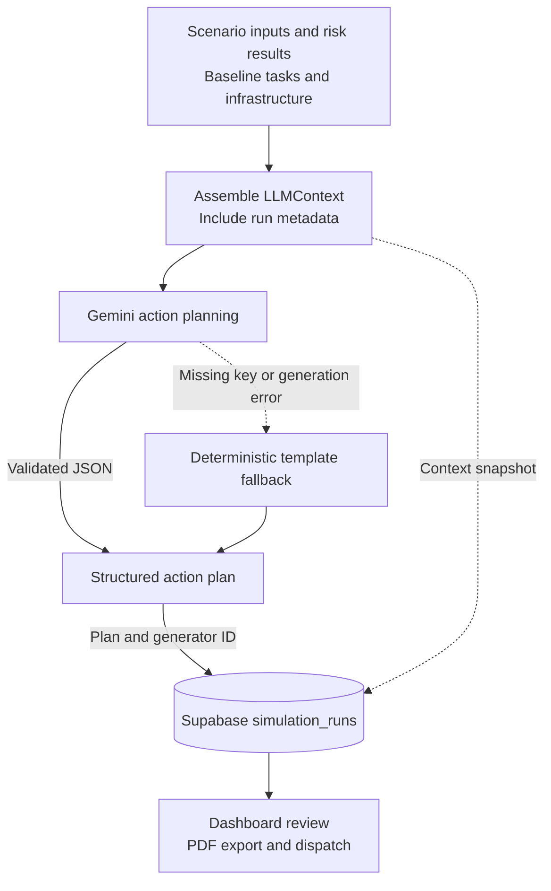

# ACTA

Context-Aware Decision-to-Action Simulation Engine for Manila flood preparedness.

ACTA combines barangay risk maps, time-sensitive tasks, and Gemini-assisted
planning to help local government unit (LGU) operators prepare a response.

[Open ACTA](https://sisig-mayo.github.io/ACTA/) |
[Quick start](#quick-start) |
[Architecture](#architecture) |
[LLM pipeline](#llm-pipeline-architecture) |
[Documentation](#documentation)

## What ACTA does

| Workflow | Operator outcome |
| --- | --- |
| Monitor | Review barangay risk maps, alerts, priority areas, and resource summaries. |
| Simulate | Model wind, rainfall, preparation time, and storm track to identify flood risk zones. |
| Plan | Generate prioritized tasks, deadlines, and explanations grounded in the scenario. |
| Review and dispatch | Approve a Master Action Plan, export a PDF, and submit it to the dispatch hook. |
| Demonstrate | Choose **Use Demo Result** to explore a local scenario without a simulation API call. |

The current implementation focuses on flood preparedness. Resource inventory
uses static data, and routing UI integration and dispatch history remain
improvement areas. See [features and current gaps](docs/docs/product/features.md)
for capability details.

## Quick start

You need Flutter with Dart `^3.12.2`, Python 3.11+, and a Supabase PostgreSQL
project with PostGIS and pgRouting. The commands below target Chrome and start
from the repository root.

### 1. Configure the environment

```sh
cp .env.example backend/.env
```

The backend and seed scripts read `backend/.env`. Fill in these values, or
supply them as process environment variables:

| Variable | Purpose |
| --- | --- |
| `SUPABASE_URL` | Supabase project URL. |
| `SUPABASE_SERVICE_ROLE_KEY` | Server-side access to Supabase. |
| `SUPABASE_DATABASE_URL` | PostgreSQL connection string. |
| `GEMINI_API_KEY` | Optional: enable AI-generated action plans. |
| `GEE_SERVICE_ACCOUNT_FILE` | Optional: enable Google Earth Engine integration. |

Leave optional credentials empty if those services are not configured.

### 2. Install dependencies

```sh
flutter pub get
python -m venv backend/.venv
```

On macOS or Linux, activate the environment:

```sh
source backend/.venv/bin/activate
```

On Windows PowerShell:

```powershell
.\backend\.venv\Scripts\Activate.ps1
```

Install the backend and GeoJSON import dependencies:

```sh
python -m pip install -r backend/requirements.txt
python -m pip install psycopg2-binary
```

### 3. Prepare the database

Apply the SQL files in [database/migrations/](database/migrations/) in filename
order, through `008_risk_scoring_optimization.sql`, using the Supabase SQL Editor
or `psql`.

> Two migrations share the `007` prefix. Run `007_barangay_geojson_rpc.sql`,
> then `007_llm_pipeline_columns.sql`, before `008`.

Place your Manila barangay GeoJSON at `data/raw/manila.geojson`, then import it
with the active Python environment:

```sh
python database/seed_geojson_handler.py --file data/raw/manila.geojson
```

Use a GeoJSON `FeatureCollection` in EPSG:4326 with Polygon or MultiPolygon
geometry and `barangay_name` / `district` properties. The importer also accepts
source aliases such as `adm4_name` / `adm2_name`. Raw spatial files are ignored
by Git.

After seeding or changing barangay boundaries, refresh the cached exposure data
in the database:

```sql
SELECT refresh_barangay_exposure_summary();
```

See the [data and database reference](docs/docs/reference/data-and-database.md)
for schema and storage details.

### 4. Run ACTA

Start the backend with the Python environment active:

```sh
cd backend
uvicorn main:app --reload --host 0.0.0.0 --port 8000
```

Start the dashboard in a second terminal from the repository root:

```sh
flutter run -d chrome --dart-define=ACTA_API_BASE_URL=http://localhost:8000
```

| Local service | Address |
| --- | --- |
| Backend health | [localhost:8000/health](http://localhost:8000/health) |
| Interactive API docs | [localhost:8000/docs](http://localhost:8000/docs) |

`ACTA_API_BASE_URL` overrides the deployed backend default in
[api_config.dart](lib/config/api_config.dart). For a device or emulator, use an
address reachable from that target.

Sign in, configure a flood simulation, and review the resulting action plan.
Choose **Use Demo Result** for a local prototype walkthrough.

## Architecture

| Component | Location | Responsibility |
| --- | --- | --- |
| Flutter dashboard | [lib/](lib/) | Operator screens, Riverpod state, and Flutter Map views. |
| FastAPI backend | [backend/](backend/) | Authentication, simulations, routing, PDF generation, and dispatch. |
| Spatial database | [database/](database/) | Supabase PostgreSQL, PostGIS, pgRouting, migrations, and seed scripts. |
| Data ingestion | [data_pipeline/](data_pipeline/) | Hazard telemetry ingestion and archiving. |
| Technical docs | [docs/docs/](docs/docs/) | MkDocs source pages. |

The dashboard submits a scenario to FastAPI and polls its status. The background
pipeline computes barangay flood risk, updates route costs, and generates tasks
from the preparation window. Results are stored in Supabase for operator review,
PDF export, and dispatch. See [system architecture](docs/docs/development/architecture.md)
for the full runtime flow.

## LLM pipeline architecture

The planning stage combines simulation data into one context document. Gemini
refines the baseline tasks into an action plan; a deterministic template supplies
the same response structure when Gemini is unavailable.



### What goes into the context

| Section | Contents |
| --- | --- |
| Scenario | Wind, rainfall, preparation window, storm track, and impact radius. |
| Risk results | Severity, zone counts, top 15 risk barangays, and red-zone names. |
| Infrastructure | Pumping station and drainage gate status, when available. |
| Baseline tasks | Time-decay tasks for refinement, including priorities and deadlines. |
| Run metadata | Run ID, assembly timestamp, and pipeline version. |

The plan contains `action_plan_tasks`, an `explainability_card`, and a
`risk_assessment`. Both generation paths return `LLMActionPlanResponse`;
`generated_by` identifies the model or `fallback-template`.

Completed runs expose the stored plan and context snapshot through
`GET /api/v1/simulation/llm-context/{run_id}`.

For source files, response fields, and fallback behavior, see the
[LLM pipeline reference](docs/docs/reference/llm-pipeline.md).

## Documentation

| Topic | Guide |
| --- | --- |
| Local setup | [Installation](docs/docs/getting-started/installation.md) |
| Running and building | [Running ACTA](docs/docs/getting-started/running-acta.md) |
| Operator workflow and limitations | [Features and current gaps](docs/docs/product/features.md) |
| Configuration | [Environment variables and project settings](docs/docs/reference/configuration.md) |
| Backend endpoints | [API reference](docs/docs/reference/api.md) |
| Database and spatial data | [Data and database](docs/docs/reference/data-and-database.md) |
| Hazard ingestion | [Data pipeline](docs/docs/reference/data-pipeline.md) |
| AI planning | [LLM pipeline](docs/docs/reference/llm-pipeline.md) |
| Repository layout | [Project structure](docs/docs/reference/project-structure.md) |
| Troubleshooting | [Common setup and runtime issues](docs/docs/operations/troubleshooting.md) |

Preview the documentation from the repository root:

```sh
python -m pip install mkdocs
python -m mkdocs serve -f docs/mkdocs.yml
```

Build and validate the static site:

```sh
python -m mkdocs build --strict -f docs/mkdocs.yml
```

Edit pages in `docs/docs/` and navigation in [docs/mkdocs.yml](docs/mkdocs.yml).
The generated site is written to `docs/site/`. The repository's GitHub Pages
workflows publish the Flutter app; publish the documentation to a separate
destination to keep the app URL intact.

## Contributing

Use [Conventional Commits](https://www.conventionalcommits.org/) with the format
`type(scope): message`, for example:

```text
feat(backend): add flood-aware routing
fix(frontend): correct risk zone labels
docs(readme): clarify local setup
```

Follow the [development workflow](docs/docs/development/workflow.md) for code
style, validation commands, and documentation updates.

## License

Proprietary. All rights reserved.
